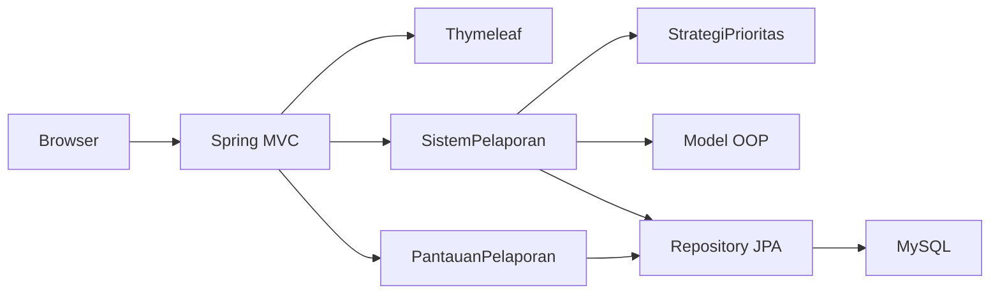

# Arsitektur aplikasi

Spring MVC menerima request dan mengembalikan halaman Thymeleaf. Controller menangani binding form, validasi, identitas pengguna yang masuk, dan redirect. Paket `security` berisi `SecurityConfig` (aturan route per peran), `PenentuPeran` (email/NIM ke peran), `AkunMasuk` (principal sesi), dan `PembatasPercobaanMasuk`. `SistemPelaporan` mengoordinasikan transaksi perubahan data. `PantauanPelaporan` menyediakan pembacaan untuk dashboard, daftar, dan detail. Repository menggunakan Spring Data JPA dan basis data MySQL. Relasi yang dibutuhkan template dimuat sebelum transaksi pembacaan berakhir.

## Penyimpanan

| Tabel | Isi |
| --- | --- |
| `pengguna` | Mahasiswa, admin, dan petugas dengan discriminator `peran`. `kontak` berisi email (unik, huruf kecil), `nim` unik untuk mahasiswa (V3). Keahlian, jadwal, dan kesibukan tersedia untuk petugas. |
| `fasilitas` | Jenis, gedung, ruang, jumlah unit, dan kondisi. |
| `laporan_kerusakan` | Satu pengiriman mahasiswa, terkait fasilitas dan kasus. |
| `kasus_kerusakan` | Sekumpulan laporan terkait, status, hasil verifikasi, dan alasan prioritas. |
| `tugas_perbaikan` | Satu penugasan per kasus, petugas dan admin terkait, waktu dan catatan. |

Foreign key menjaga referensi dan batas unik pada `tugas_perbaikan.kasus_id` mencegah dua tugas untuk satu kasus. Flyway menyimpan versi skema dan seed pada `flyway_schema_history`.

## Transaksi dan konsistensi

- Semua perubahan bisnis menggunakan transaksi dengan isolasi `READ_COMMITTED`. Laporan, verifikasi, pemisahan, dan progres memakai lock tulis pada baris fasilitas terkait. Laporan paralel untuk fasilitas yang sama mencari kasus setelah mendapat lock tersebut.
- Kunci penggabungan otomatis memakai fasilitas, jenis kerusakan, status aktif, dan penanda pengelompokan otomatis. Pemisahan administratif membuat kasus baru di luar pengelompokan otomatis. Kasus asal dan kasus terpisah masing-masing memiliki laporan untuk diperiksa.
- Penugasan dan penyelesaian mengambil lock fasilitas terlebih dulu, lalu lock petugas. Penugasan memeriksa tugas aktif, jadwal, dan keahlian dalam transaksi yang sama. Penyelesaian memperbarui tugas, kasus, dan petugas, lalu menghitung kondisi fasilitas dari kasus yang masih aktif.
- Submit berhasil memakai pola Post/Redirect/Get. Validasi form dicetak ulang untuk mempertahankan input. Akses detail yang tidak ditemukan atau tidak terkait dengan akun yang masuk mengembalikan HTTP 404. Spring Security memeriksa peran setiap route, menyimpan identitas di sesi, mengganti ID sesi setelah masuk, dan mewajibkan token CSRF untuk semua form POST termasuk login dan logout.
- Jam kerja, pencatatan laporan, dan penugasan menggunakan `Clock` berzona `Asia/Jakarta`. Jam mulai dan selesai yang sama merepresentasikan ketersediaan 24 jam pada demo. Shift yang melewati tengah malam juga didukung.
