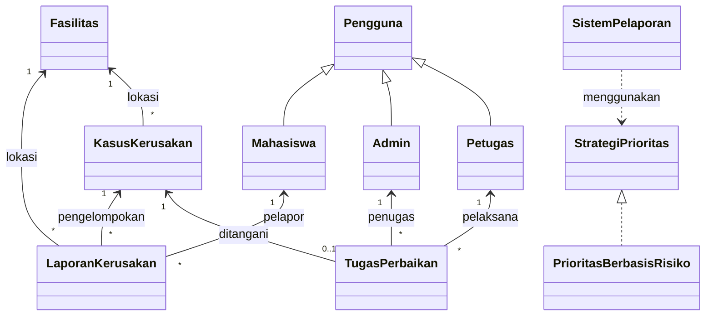

# Penerapan OOP

| Kelas atau interface | Tanggung jawab |
| --- | --- |
| `Pengguna` | Kelas abstrak untuk nama, kontak, dan kontrak `bolehMelakukan(Aksi)`. |
| `Mahasiswa` | Membentuk objek laporan melalui `buatLaporan()`. |
| `Admin` | Membuat penugasan setelah keahlian, jadwal, dan status kasus memenuhi syarat. |
| `Petugas` | Memeriksa kasus serta menilai kecocokan keahlian dan ketersediaan. |
| `Fasilitas` | Menyimpan lokasi, jumlah unit, kebutuhan keahlian, dan kondisi. |
| `LaporanKerusakan` | Memvalidasi isi laporan dan menjaga referensi ke fasilitas, pelapor, dan kasus. |
| `KasusKerusakan` | Menjaga kelompok laporan, pelapor unik, verifikasi, prioritas, dan urutan status. |
| `SistemPelaporan` | Service yang mengoordinasikan transaksi, penggabungan, verifikasi, penugasan, dan progres. |
| `StrategiPrioritas` | Interface dengan operasi `tentukan()` dan `jelaskan()`. |
| `PrioritasBerbasisRisiko` | Implementasi strategi yang menilai bahaya kritis dan tingkat gangguan. |
| `TugasPerbaikan` | Menjaga urutan mulai, catatan progres, dan penyelesaian. |

## Contoh untuk presentasi

- **Encapsulation.** Field entitas bersifat privat. `TugasPerbaikan.selesaikan()` memeriksa status dan catatan sebelum menyinkronkan tugas, kasus, dan kesibukan petugas. Daftar laporan ditampilkan melalui koleksi baca, sementara pengelolaannya dilakukan oleh kasus.
- **Inheritance dan polymorphism.** `Mahasiswa`, `Admin`, dan `Petugas` mewarisi `Pengguna`. Pemanggilan `bolehMelakukan()` menjalankan implementasi sesuai peran objek. Pemetaan JPA memakai satu tabel `pengguna` dengan kolom pembeda `peran`.
- **Abstraction dan interface.** `SistemPelaporan` menggunakan kontrak `StrategiPrioritas`. Kebijakan yang dipakai saat ini dipasang melalui dependency injection sebagai `PrioritasBerbasisRisiko`.
- **Exception handling.** Input yang melanggar nilai domain memicu `IllegalArgumentException`. Transisi yang melanggar urutan memicu `IllegalStateException`. Data yang tidak ditemukan memakai `DataTidakDitemukan`. Transaksi dibatalkan ketika aksi gagal.
- **Adaptasi framework.** Entitas persisten memiliki primary key dan konstruktor tanpa argumen untuk JPA. Enum menyatakan kategori yang tetap. Controller, form record, service pembacaan, repository, dan konfigurasi menangani integrasi MVC serta persistence.

## Hubungan antar kelas

